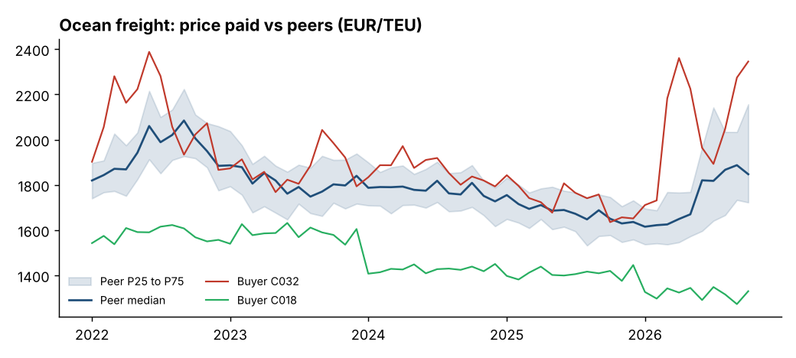

# Procurement price benchmark

How much does an oil price shock change what a company pays for freight, chemicals and packaging, how quickly does it arrive, and which buyers pay more than their peers?

This project combines **public market data** with an **anonymised, synthetic peer-price dataset** to answer those questions the way a procurement analytics team would: benchmarks, pass-through analysis and a short insight brief for non-technical readers.

**Read the findings: [REPORT.md](REPORT.md) or the two-page [PDF brief](reports/Procurement_Oil_Shock_Brief.pdf)**



## What it does

| Step | Module | Output |
|---|---|---|
| Load and rebase market drivers (Brent crude, Henry Hub gas, US CPI) | `src/ppb/market.py` | Monthly indices, Jan 2022 = 100 |
| Simulate a peer community of 60 buyers across 5 categories | `src/ppb/simulate.py` | `data/community_prices_synthetic.csv` |
| Peer quartiles and each buyer's price position | `src/ppb/benchmark.py` | Benchmark bands, relative price |
| Savings if buyers above P25 paid the P25 price | `src/ppb/benchmark.py` | `reports/savings_to_p25.csv` |
| Lag and elasticity of each category to oil | `src/ppb/benchmark.py` | `reports/pass_through.csv` |
| Should-cost impact of the 2026 oil shock on a EUR 100m spend | `src/ppb/benchmark.py` | `reports/shock_impact.csv` |

## Data

- **Real, public:** monthly Brent crude, Henry Hub natural gas and US CPI from the open [datasets](https://github.com/datasets) collection (`data/raw/`).
- **Synthetic:** purchase prices and volumes for 60 anonymised companies. Each category follows a should-cost model (weights on oil, gas, inflation and a fixed share), and buyers differ in negotiated price level, contract indexation and pass-through lag. The data is generated, not observed, so the benchmark findings illustrate the method rather than describe real companies. The market moves are real.

## Run it

```bash
pip install -r requirements.txt
python run.py      # builds the dataset, figures and CSV outputs
pytest -q          # 6 tests
```

## Notes

- The pass-through analysis picks, per category, the lag at which the median price correlates best with Brent and reports the log-log slope as elasticity.
- Built with AI-assisted development; analysis design, validation and conclusions are my own.

Author: Khoa Pham, [LinkedIn](https://www.linkedin.com/in/khoa-p-920933226/)
