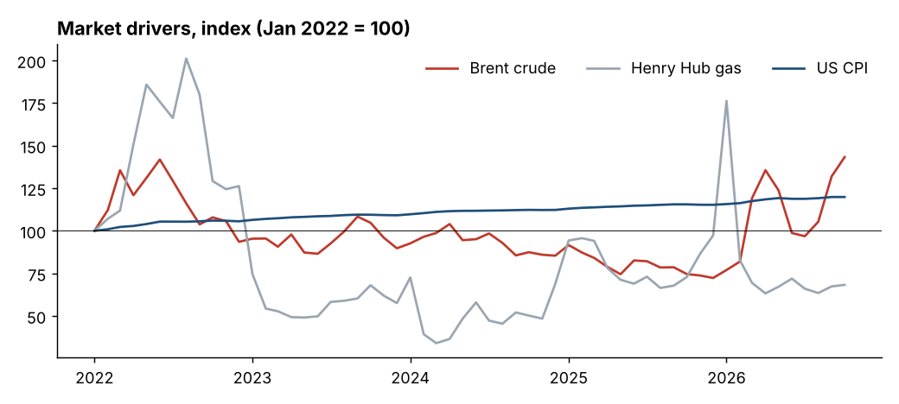
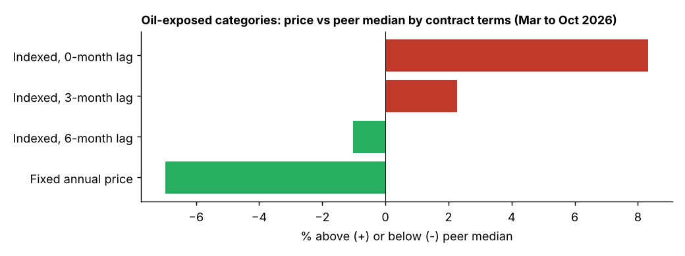
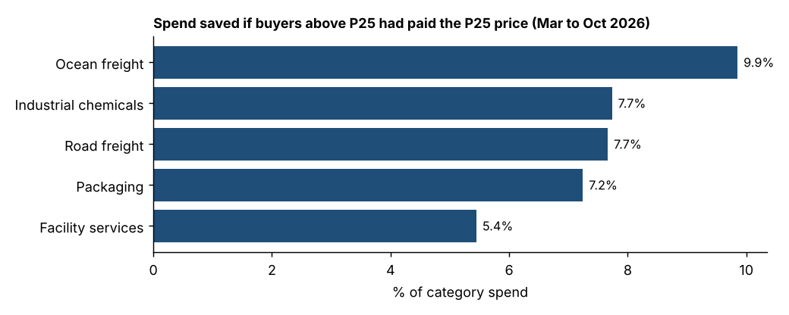
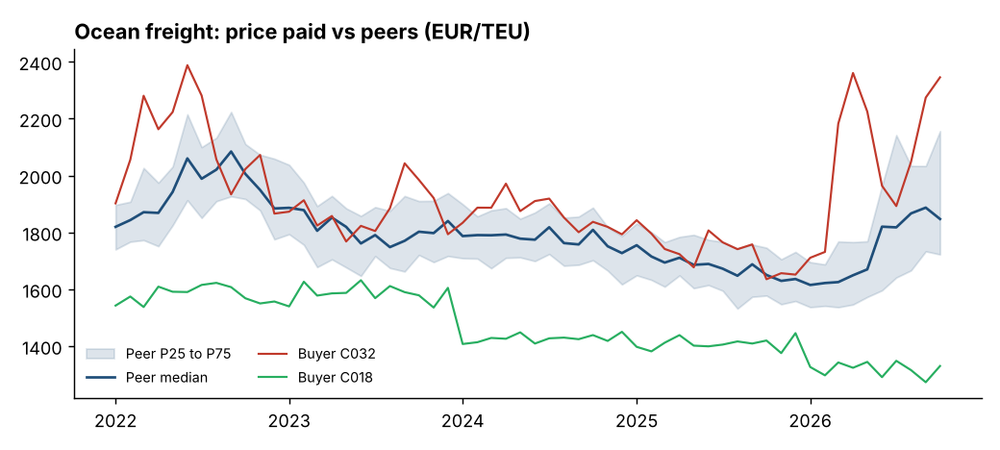

# The 2026 oil shock: what it means for procurement

*Insight brief built from public market data and an anonymised, synthetic peer-price dataset. See [README](README.md) for method and caveats.*

## The headline

Brent crude went from **USD 64.5/bbl in October 2025 to USD 123.9/bbl in October 2026, up 92%**. For a company spending **EUR 100m** across five typical indirect and logistics categories, the should-cost model puts the bill **EUR 25.8m higher** than a year earlier if nothing is done. Three quarters of that sits in just two categories.

## 1. Freight carries the shock, services barely notice it

| Category | Share of spend | Should-cost change, Oct 25 to Oct 26 | Impact on EUR 100m |
|---|---|---|---|
| Ocean freight | 25% | +43% | EUR 10.9m |
| Industrial chemicals | 20% | +31% | EUR 6.3m |
| Road freight | 20% | +26% | EUR 5.3m |
| Packaging | 20% | +15% | EUR 2.9m |
| Facility services | 15% | +3% | EUR 0.4m |

**So what:** a procurement team does not need to fight the whole cost base. Ocean freight and chemicals are where the attention, the hedging conversations and the supplier negotiations should go first.

## 2. Price moves arrive about three months after oil does

Across the peer group, the median purchase price in every oil-exposed category tracks Brent best with a **three-month lag**. Industrial chemicals are the most sensitive (elasticity 0.43: a 10% oil move becomes about a 4% price move), ocean freight follows oil most closely (correlation 0.92).

**So what:** the September and October 2026 spike has not yet reached most invoices. Budgets for Q1 2027 should already assume it, and buyers have a short window to negotiate before index clauses catch up.

## 3. Contract design mattered as much as negotiating skill

In oil-exposed categories between March and October 2026, buyers on **fixed annual prices paid 7% below the peer median**, while buyers whose contracts passed index changes through **immediately paid 8% above it**. Six-month lags roughly neutralised the shock.

**So what:** the cheapest buyer in a rising market is often the one with the right clause, not the hardest negotiator. The same fixed-price buyers will pay above market once prices fall, so the real lesson is to choose indexation terms deliberately, category by category, rather than inherit them.

## 4. The gap between buyers is the opportunity

Within the same category and month, prices paid differ widely. If every buyer above the peer 25th percentile had paid the P25 price, spend would have been **5% to 10% lower**, with ocean freight showing the widest spread.

**So what:** a peer benchmark turns "are we paying too much?" into a number per category. Buyer C032 above has paid at or above the peer P75 for most of the period, which is a conversation worth having with its carriers; buyer C018 shows what consistently good terms look like.

## Recommendations for a procurement leader

1. **Re-baseline 2027 budgets now** for freight and chemicals: the three-month lag means the autumn spike is still in the pipeline.
2. **Review indexation clauses** in oil-exposed contracts and set lag and caps on purpose.
3. **Use peer benchmarks** to prioritise renegotiation where you sit above the median, starting with ocean freight.
